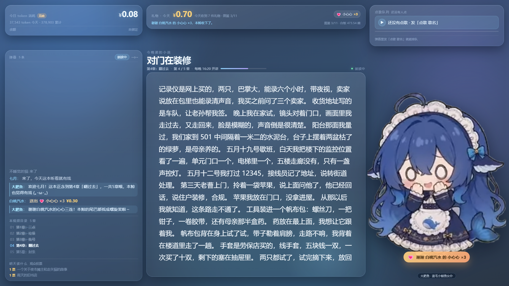

# 大肥鱼 · 抖音「故事电台」直播页

给 OBS 用的 1920×1080 直播场景：**大肥鱼**（蓝毛鲸鱼女仆）在一间深蓝色的邮局里，一晚讲一个 60 分钟的故事——开场 10 分钟，之后 5 轮「讲 6 分钟 + 互动 4 分钟」。观众可以点歌、可以用「期待后续」改剧情，礼物会当场道谢。

- 左上：今日 token 消耗 + 账户余额
- 中间上方：实时弹幕（抖音直播间抓来的 + 大肥鱼自己的回话）
- 中间：故事正文（打字机逐字写出来）
- 中间下方：本段总结（20–60 字：发生了什么 / 拿到什么线索 / 留下什么悬念）
- 左下：点歌队列
- 右上：礼物与礼物感谢（只说真收到的）
- 右中下：大肥鱼的活动区（讲、敲桌、挥手、吃白饭、吐泡泡、写字）



仓库：<https://github.com/newbeejmc/Dsh_douyin>

---

## 1. 三步跑起来

```bat
:: 1) 装两个小依赖（只有弹幕直连用得到：ws + protobufjs）
npm install

:: 2) 第一次跑，先把示例配置复制一份（里面有 Key、房间号要你自己填）
copy config.example.json config.json

:: 3) 启动（默认 8787 端口）
node server.mjs
```

> 仓库里只有 `config.example.json`（Key 和房间号都是空的）；`config.json` 是你的真实配置，已被 `.gitignore` 排除，不会上传。

2. **双击 `打开直播间.cmd`** —— 打开一个没有地址栏的 1920×1080 窗口，**带声音、不用点任何东西**（内部就是 `chrome --autoplay-policy=no-user-gesture-required --app=http://127.0.0.1:8787/?auto=1`）。
   不想用这个窗口，也可以自己开浏览器访问 <http://127.0.0.1:8787>，但第一次要点一下页面底部的「🔊 点一下，开启声音」。
3. 打开 <http://127.0.0.1:8787/admin> —— 操作台：填 **DeepSeek API Key**、填**直播间号连弹幕**、改故事大纲、造测试弹幕、看发送箱。

> Windows 也可以双击 `start.cmd` 起服务（第一次会自动 `npm install`）。Key 只存本机 `config.json`，除了 `api.deepseek.com` 不外发。

不填 Key 也能跑：故事按大纲原文 + 语气提示兜底念出来，弹幕用固定话术回，页面照常显示礼物和弹幕，token 花费恒为 0。

---

## 2. 一场 60 分钟是怎么排的

| 时间 | 阶段 | 大肥鱼在做什么 |
| --- | --- | --- |
| 0–10 分 | 开场 | 5 拍，每拍 420～520 字（各约 2 分钟）：环境、时间地点、主角身份与性格、当前的问题、重要人物、没解释的线索、核心悬念；结束前会说「接下来，故事会走向哪里，由你们来决定。」 |
| 10–17 分 | 第 1 轮 · 讲述 | **一口气讲满 6～7 分钟**（1400～1600 字，把这一段几个节点全部展开，结尾留一个选择） |
| 17–20 分 | 第 1 轮 · 互动 | 念本段总结、给 2–3 个方向、收「期待后续」、答弹幕、谢礼物、处理点歌、定下一段方向 |
| 20–27 / 27–30 分 | 第 2 轮 | 同上 |
| 30–37 / 37–40 分 | 第 3 轮 | 同上 |
| 40–47 / 47–50 分 | 第 4 轮 | 同上 |
| 50–57 / 57–60 分 | 第 5 轮 + 收束 | 同上，最后把这一晚收住 |

每轮「讲述 + 互动」正好 10 分钟，5 轮 50 分钟，加开场 10 分钟 = 60 分钟；讲长了会自动顺延下一条。

每一轮结束都会存一条「本段总结」，下一段会带着它继续讲，所以不会忘前面发生过什么。观众没提建议时，按这一段写好的「默认后续」推进。

**字数**：「讲 6～7 分钟」是写死在提示词里的硬要求（`lib/story.mjs` 的 `taskOf` → `1400～1600 个汉字`，`maxTokens: 3200`、超时 240 秒）。按现在的排法，一场下来是 **9,000～10,000 字**（开场 5×470 + 5×1500），远超「整体 6000 字」。实测单段 1639 字，念出来 6 分半。

> 这么长的段子建议用 **edge 音色**（在线，一句 2–3 秒）；本地 Kokoro 在 CPU 上合成 1600 字要四五分钟，会跟不上。

时间长度都能在 `/admin → 2 · 故事电台` 里改（开场/讲述/互动/整场分钟数），也能在 `config.json → story` 里改。

---

## 3. 弹幕怎么进来（四种方式）

### 方式 A：内置直连（推荐，不用浏览器、不用扩展）

内置了开源的抖音弹幕协议（`vendor/douyin-danma`，来自 `cortico-world-douyin-live`，GPL-3.0）：进程里直接连抖音网页直播的长连接，把弹幕 / 礼物 / 进场 / 关注 / 点赞解出来。

1. 打开 <http://127.0.0.1:8787/admin> → **2 · 弹幕接入**。
2. 填你的直播间号（`live.douyin.com/` 后面那串数字，或者整条链接都行），点「连上」。
3. 状态变 `live` 就开始收；没开播是 `waiting`，每 15 秒自动看一眼，开播自动连上；下播后也自己重连下一场。

也可以直接写进 `config.json`：`danmaku: { mode: "auto", roomId: "你的直播间号" }`，`node server.mjs` 启动时自动连。

- 只用得到 Node，**不开 Chrome、不装扩展**，直播间的人看不到你在看；
- 连的是只读通道，**不会往抖音发消息**（要说话得走方式 C 的扩展）；
- 抖音改协议时，换掉 `vendor/douyin-danma` 即可，主程序不用动。

### 方式 B：抖音网页版直播间 + 扩展（要在公屏回话时用）

直连只读，**回话**得靠扩展把字打进直播间输入框：

1. 用**电脑 Chrome** 打开自己的直播间：`https://live.douyin.com/<你的直播间号>`（直播伴侣照常推流，不冲突）。
2. `chrome://extensions` → 开「开发者模式」→「加载已解压的扩展程序」→ 选本项目的 `extension` 文件夹。
3. 回直播间页面**刷新一次**，页面右侧的弹幕会出现在 <http://127.0.0.1:8787> 上。
4. 点扩展图标可改服务地址（默认 `http://127.0.0.1:8787`），看「已上报 / 已回写」计数。

扩展做的事：

- `MutationObserver` 盯弹幕列表 DOM，拆成 **弹幕 / 礼物 / 进场 / 关注 / 点赞**，POST 到 `/api/event`；
- 每 2.5 秒拉一次 `/api/outbox`，把大肥鱼的话**打进直播间输入框并点「发送」**——观众公屏上看到的是主播亲自回的话；
- 5 秒去重、90 秒防回流（自己发的不再被当成弹幕抓一遍）。

> 扩展只认 `live.douyin.com` / `www.douyin.com`。抖音改版改了 DOM，`extension/content.js` 的 `parseLine` 要跟着调。

### 方式 C：操作台手动造（调试/排练）

`/admin → 3 · 造一条弹幕`：填昵称和内容就能发，还能送礼、造进场、以主播身份手动说话。

### 方式 D：命令行灌数据

```bat
node tools/demo.mjs
node tools/preview.mjs
```

---

## 4. 弹幕指令

| 观众发 | 大肥鱼回什么 | 副作用 |
| --- | --- | --- |
| `点歌 晴天` | 有源：「收到你的点歌：《晴天》，这就放给你听。」/ 排在后面：「…排在队列第 1 位，等《平凡之路》放完就到它。」/ 没源：「…这首歌暂时没有可用播放源，本鲸先记下歌名，稍后再帮你确认。」 | 进点歌队列，右上角显示，**能解析到音源就会出声** |
| `切歌` / `下一首` | 换到下一首 | 队列前进一首，自动解析新歌音源 |
| `期待后续 让她去灯塔上数星星` | 「收到你的后续想法，我会把它和其他观众的建议一起分析。」 | 进「观众建议」池，按出现次数排序，互动时段由 AI 参考 |
| 普通弹幕 | 1–2 句，先接住话，再带回故事 | 自动回复，1 分钟最多 8 条 |
| 送礼物 | 带昵称 + 礼物名的道谢 | 计入今日收、礼物图鉴、右上角感谢 |

只有**真收到**的礼物才会被感谢；没有音源时**不会**假装正在放歌。

---

## 4.5 音乐播放源（点歌真的会唱）

点歌队列是**真播放**：服务端把歌解析成一个能 `<audio>` 直接放的地址，浏览器里放出来，OBS 采这个页面的声音就行。

**三种源，按 `config.json → music.provider` 选**：

1. `local` — 本地曲库（最稳、无版权风险）
   把 mp3/m4a/flac/ogg/wav 放进项目下的 `music/` 目录，文件名写成 `歌手 - 歌名.mp3` 就能认出歌手。
   页面通过 `/api/music/stream/:id` 走 HTTP Range 输出，支持拖动进度条。
2. `netease` — 网易云外链
   用公开搜索接口找歌，再取 `music.163.com/song/media/outer/url?id=…` 的 mp3。
   ⚠️ 这条链是**个人试听**用的：很多歌只能拿到翻唱/免费曲，原唱常常没有；**公开直播请改用自有或无版权音源**，别拿它当商用 BGM。
3. `custom` — 自建解析服务（推荐给要长期播的人）
   GitHub 上 `Binaryify/NeteaseCloudMusicApi`（Node，`npm i && node app.js`，默认 `http://127.0.0.1:3000`）起来后，把 `music.apiBase` 填成这个地址即可。它带登录态，能拿到更全的曲库和更高码率。

**解析顺序**：`auto` = 先本地曲库（同名/包含匹配）→ 再 `netease`；`custom` 则走你自建的 API。
解析时会先用 Range 试拉 1KB 校验 `content-type` 是不是音频、文件是否 ≥300KB，**过不了就不算有源**，不会给观众放个空链接。

**操作台**：`/admin → 4 · 声音（音乐 · 大肥鱼）` 里能改来源/目录/音量、重新扫描本地曲库、搜歌试听、手动解析当前这首。

**注意**：
- 浏览器默认禁止自动播放，**第一次要在页面上点一下 ▶**（OBS 浏览器源默认允许自动播放）。
- 音量在 `music.volume`（0–1），页面右下播完会自动 `POST /api/music/ended` 切下一首。
- 只支持能直连的音频文件；网易云外链有时效性，过期会显示「播放失败」，点 ▶ 会重新解析。

---

## 4.6 大肥鱼的声音（御姐音，上线朗读）

故事的每一段不只是「写」出来，大肥鱼会**真的念出来**。默认走 **edge-tts 御姐音**（`zh-CN-XiaoxiaoNeural` + 降音高 −28Hz + 慢 8%），听着偏低、偏冷，是「深夜电台」那个味道。

**怎么开**：`/admin → ① 基础设置 → 声音 · 大肥鱼`：
- **大肥鱼音量**：台词音量（`voice.volume`，0–1），旁边「试听」念一句固定台词。
- **讲每段时出声**：总开关（`voice.enabled`）。
- **音色**：在线四个（自然 / 温柔 / 御姐冷 / 御姐低 / 原味）＋ 本地四个（Kokoro 小北 / 小妮 / 晓晓 / 晓伊）＋ 系统离线备用。
- **语速**：0.8 / 1 / 1.15 / 1.3（`voice.rate`）。
- 下方小字会显示当前是哪套参数（比如「温柔 · 晓晓 · zh-CN-XiaoxiaoNeural」）。

**三种引擎**：

| 引擎 | 音色 | 依赖 | 备注 |
| --- | --- | --- | --- |
| `edge`（默认） | 五个预设，`natural` 最自然 | 本机 Python + `pip install edge-tts` | 调微软语音接口，一句 2–3 秒，免费 |
| `kokoro`（本地，更好听） | Kokoro-82M 中文音色 4 个 | `tts-kokoro/` 下的模型 + `pip install kokoro-onnx misaki[zh]` | 完全离线，音质比 edge 更厚；CPU 上慢，一句 80 字要十几秒 |
| `sapi`（备用） | `Microsoft Huihui Desktop` | 无（Windows 自带） | 断网时的最后手段 |

**机制**：
- 一段 6–7 分钟的台词有 1400–1600 字，整段合成要等太久，所以会**切成 70–80 字的小段，边播边合成下一段**（预取一段），第一句 2–3 秒就能出声，中间不空场。
- 新一段开口前，上一段的声音会被立刻掐掉（`speakToken` 作废排队），不会两条音轨叠着说。
- 说话时 BGM 保持原音量（oice.duck 默认 ；想压低一点就设 0.25）。
- 合成本地缓存：`data/voice/<hash>.mp3|wav`，同一句只合成一次（实测 edge 首次约 2.8 秒，命中缓存直接返回）。

**本地 Kokoro 怎么装**（可选，想要更好音质时）：

```powershell
C:\Anaconda3\python.exe -m pip install kokoro-onnx soundfile espeakng-loader "misaki[zh]"
# 模型和音色已经放在 tts-kokoro/：model_quantized.onnx（92MB）+ voices.npz
# 换/加模型见 .voice-skill 里的说明；模型来自 hf-mirror（huggingface 国内镜像）
```

装好后在操作台把「音色」切到「本地 · 小北」即可，服务端会调用 `tts-kokoro/say.py` 合成。

> 想训练出**属于你自己的**音色（RVC 克隆）？见第 12 节「关于训练御姐音」——那需要一段 10 分钟的干净人声素材和一张 ≥8GB 显存的 N 卡，本机 6GB 目前没上。

> 第一次点「试听」如果没声音，多半是浏览器还没拿到用户手势——页面底部会出现「🔊 点一下，开启声音」，按一下即可；OBS 浏览器源不受这个限制。

### 打开就有声音（不用点任何东西）

浏览器默认会拦自动播放（第一次得点一下）。要「打开就出声」，用 **`打开直播间.cmd`** 双击就行，它带的参数是：

```bat
chrome.exe --autoplay-policy=no-user-gesture-required --app=http://127.0.0.1:8787/?auto=1 ^
           --window-size=1920,1080 --user-data-dir="data\chrome-live"
```

- `--autoplay-policy=no-user-gesture-required`：浏览器放行自动播放，打开即出声；
- `--app=...`：没有标签栏/地址栏的窗口，直接投 OBS 或副屏；
- `?auto=1`：页面走「自动模式」，不再显示「🔊 点一下，开启声音」那个按钮；
- `--user-data-dir`：单独一个浏览器配置，不碰你平时的 Chrome。

> 用普通标签页打开（`http://127.0.0.1:8787/`）时，仍然保留那个兜底按钮——点一下之后同页面就一直有声了。OBS 的浏览器源默认就允许自动播放，不用点。

### 点歌会自动往下播

- 队列里只要有歌，页面就会自己播，不用手动点 ▶（`renderSong` 里直接 `play()`）。
- 一首放完 → 前端 `POST /api/music/ended` → 服务端把下一首设成当前曲、解析音源 → 推 `song` 事件 → 页面自动播下一首。
- 想手动暂停/继续，点队列卡左边的 ▶ / ❚❚。

### 音乐和讲述同时响

两条音轨各走各的：BGM 走 `<audio id="player">`（音量 `music.volume`，默认 0.75），大肥鱼的声音走 `<audio id="voicePlayer">`（音量 `voice.volume`，默认 0.9），互不打断、同时出声。

想让讲述时 BGM 让一让，把 `config.json → voice.duck` 设成 `0.3`（说话时 BGM 压到 30%，说完恢复）；默认 `1` 就是不压。

### 每次打开直播窗，自动清场

窗口一打开（页面加载），前端会先 `POST /api/session/boot`，服务端把这些清空再让页面连 SSE：

- **音乐**：清空点歌队列，当前曲目也置空（不再「上次那首还挂着」）；
- **消息**：清空发送箱里待回写的弹幕、以及还没轮到回复的队列；
- **弹幕**：整条清空，之后最多只保留 **50 条**（服务端 `MAX_EVENTS = 50`，页面同样只留 50 行）。

OBS 刷新浏览器源、每天开播重开窗口，都会从干净状态开始。调试时不想被清，就在地址后面加 `?keep=1`。

### 浏览器没声音？三查

1. 直播页底部有没有「🔊 点一下，开启声音」——有就点它（Chrome 的自动播放策略）。
2. `/admin → ① 基础设置 → 声音 · 音乐` 点「测试音」：能听到 880Hz 的「叮」说明浏览器和扬声器都正常，问题在音源；听不到就是系统/浏览器音量或输出设备的问题。
3. 点「试听当前这首歌」：它不看弹幕、直接播当前曲目；如果这里没声，去 `/api/state` 看 `song.currentSong.url` 是否为空（空就是没解析到音源）。

---

## 4.7 AI 撞上 503「服务太忙」怎么办

DeepSeek 高峰期偶尔会甩回来一句：

```
DeepSeek 503: Service is too busy. We advise users to temporarily switch to alternative LLM API service prov
```

这不是配置错了，是它那边排队。程序现在会**三层兜底**，尽量不让你听到「兜底稿」：

1. **退避重试**：同一个模型最多重试 3 次，间隔 1.2 秒 → 2.4 秒 → 4.8 秒（服务端给了 `retry-after` 就按它等）；
2. **换备用模型**：主模型还不行就换 `ai.fallbackModel`（默认 `deepseek-chat`）；
3. **换备用接口**：前两层都挂了，且你填过 `ai.backup`（地址 + Key + 模型名），就用另一家的接口顶上。

三层都失败才算真失败。真失败时：
- 开场 / 讲述这种长段**不会**拿大纲原地糊过去：会推一条「这一段先等 5 秒，自动重来一次」，5 秒后重来同一条（最多重来两次）；
- 两次都不行才用兜底稿把这 ~10 分钟填上，下一段继续照常走，直播不会停；
- 操作台 `① 基础设置` 的 DeepSeek 卡片下面会出现橙色的「上次 AI 没接上：…」，恢复后自动消失。

**在哪儿填**：`/admin → ① 基础设置` 多了三行——「备用模型」「备用接口（地址 + Key）」「备用模型名」；也可以直接改 `config.json`：

```json
"ai": {
  "model": "deepseek-flash",
  "fallbackModel": "deepseek-chat",
  "retryAttempts": 3,
  "backup": { "baseUrl": "", "apiKey": "", "model": "" }
}
```

> 备用接口留空就是「只重试 + 只换模型」，不花钱也不折腾。

**自测**：`node tools/fake-503.mjs 8899 flash-busy` 起一个假接口，把 `ai.baseUrl` 临时指到 `http://127.0.0.1:8899`，再去点「测一句话」——能看到它重试 3 次后自动切到 `deepseek-chat` 成功返回。`fake-503.mjs 8899 all-busy` 则是所有模型都忙，用来验证最终的报错文案。

---

## 5. 关于「我用的是抖音直播伴侣」

**结论：推流照旧用直播伴侣；弹幕不用从伴侣里想办法——本项目在 Node 进程里直连抖音的弹幕长连接。**

原因：直播伴侣是闭源桌面客户端，弹幕走它自己的私有长连接（protobuf + 签名），没有对外接口；开放平台只对报备过的「直播小玩法」开发者开放，个人拿不到。

**所以分工是这样：**

- 画面：直播伴侣照常推流，画面来源加「窗口/浏览器」选本页面；
- 弹幕/礼物：`/admin → 2 · 弹幕接入` 填直播间号，进程里直连抖音（见第 3 节方式 A），**不需要开网页**；
- 回话（可选）：想让大肥鱼的话出现在公屏，就再开一个 Chrome 打开自己的直播间，装 `extension`，它会把话打进输入框（见方式 B）。不回话也可以，弹幕照样能收、礼物照样道谢。

好处：整个链路只有 Node 一个进程，CPU 占用低，直播间里也看不到你在看。

**不推荐的两条路**：① 用 CDP 连直播伴侣的 Electron 内核去读 DOM（版本一更新就可能失效）；② 屏幕 OCR 认弹幕（昵称和礼物容易认错，延迟也大）。

---

## 6. OBS 怎么采

- **窗口采集**：OBS → 来源 → 窗口采集 → 选 Chrome 窗口（`大肥鱼 · 写故事直播间`），裁掉浏览器边框。
- **浏览器源**：URL 填 `http://127.0.0.1:8787/`，宽 1920 高 1080；宠物是 webm 动画，浏览器源能播。
- 页面是**流体布局**：铺满浏览器窗口，两边不留白，字号随窗口缩放（`clamp`）。OBS 画布按 1920×1080 开就行，窗口拉到多大它铺多大。
- **透明底叠加**：给页面加 `?bare=1`（`http://127.0.0.1:8787/?bare=1`），背景层淡出，卡片和字还在，适合叠到自己拍的画面上。

直播伴侣里同理：添加「窗口」或「浏览器」来源。

---

## 7. token 花费和余额怎么算

- 每次调用 DeepSeek 都记 `usage`（缓存命中输入 / 未命中输入 / 输出），按**官方现价 × 当前时段**算钱：
  - `deepseek-flash`：命中 ¥0.02/M、未命中 ¥1/M、输出 ¥4/M（空闲）；高峰 ¥0.04 / ¥2 / ¥8。
  - 高峰 = 周一至周五 9:00–12:00、14:00–18:00（北京时间）。
  - 单价在 `config.json → pricing`，官方调价改这里。
- 余额来自 `GET /user/balance`，进页面查一次，60 秒复用；操作台有「刷新余额」。
- 「今日收」= 礼物单价 × 数量（`config.json → gifts`）。
- 「白饭余额」= `riceBase + 今日收 × 0.1`，纯玩法数值。

---

## 8. 配置（`config.json`）

| 字段 | 说明 |
| --- | --- |
| `port` | 服务端口，默认 `8787` |
| `roomId` | 你的直播间号（只用于提示/日志） |
| `ai.apiKey` | DeepSeek Key（也可用环境变量 `DEEPSEEK_API_KEY`） |
| `ai.model` | `deepseek-flash`（便宜）或 `deepseek-v4-pro`（更会讲） |
| `ai.temperature` / `ai.maxTokens` | 说话风格 / 单句上限 |
| `ai.minReplyGapMs` / `ai.maxRepliesPerMinute` | 回弹幕的最小间隔 / 每分钟上限 |
| `ai.replyToGifts` | 收到礼物是否答谢 |
| `reply.auto` | `false` 时只显示弹幕、不自动回 |
| `story.enabled` / `story.auto` | 故事自动开讲 / 自动往下讲 |
| `story.title` `genre` `world` `hero` `cast` `conflict` `mystery` `ending` | 故事设定（标题/类型/世界观/主角/人物/冲突/未解之谜/结局方向） |
| `story.immutable` / `story.changeable` | 不可改的设定 / 可以被观众改的部分（数组） |
| `story.openerMin` `storyMin` `interactMin` `totalMin` | 开场 / 每轮讲述 / 每轮互动 / 整场分钟数 |
| `story.opener` | 开场每一拍（数组，一行一拍） |
| `story.rounds` | 5 段，每段 `{chapter, beats[], defaultNext, choices[]}` |
| `danmaku.mode` | `auto`（填了房间号就直连）/ `off`（只认扩展） |
| `danmaku.roomId` | 直播间号，启动时自动连（也可在 `/admin` 里填） |
| `music.provider` | 音源：`auto` / `local` / `netease` / `custom` |
| `music.dir` | 本地曲库目录，默认 `music`（文件名 `歌手 - 歌名.mp3`） |
| `music.volume` | 页面播放音量 0–1 |
| `music.apiBase` | 自建 NeteaseCloudMusicApi 地址，如 `http://127.0.0.1:3000` |
| `voice.enabled` | 每段故事要不要出声朗读 |
| `voice.volume` | 大肥鱼音量 0–1 |
| `voice.rate` | 语速倍率 0.6–1.6（1 = 正常） |
| `voice.engine` | `edge`（在线，默认）/ `kokoro`（本地）/ `sapi`（系统离线） |
| `voice.preset` | edge：`natural` `warm` `leng` `diyin` `xiaoxiao`；kokoro：`xiaobei` `xiaoni` `xiaoxiao` `xiaoyi` |
| `voice.duck` | 说话时 BGM 压到多少，`1` = 不压（默认，音乐和讲述同时响） |
| `voice.voice` | sapi 用的音色名，默认 `Microsoft Huihui Desktop` |
| `salaryTarget` / `riceBase` | 工资条分母 / 白饭初始碗数 |
| `gifts` | 礼物表：`name` / `emoji` / `price`（元/个），顺序即图鉴顺序 |

`/admin` 里的「故事电台」是结构化编辑器：改完点「保存设定并重讲」，会从这一场开头重来。

---

## 9. 目录

```
server.mjs            HTTP + SSE、回复队列、计费、点歌、故事电台调度
start.cmd             起服务（第一次自动 npm install）
打开直播间.cmd        打开带声音的直播窗口（app 模式 + 放行自动播放）
lib/config.mjs        配置读写（隐藏 apiKey 再下发）
lib/story.mjs         60 分钟排期、分阶段提示词、本段总结、观众建议
lib/cortico.mjs       弹幕直连：房间解析 + 长连接桥（进程内，不用浏览器）
lib/music.mjs         点歌音源：本地曲库 + 网易云外链 + 自建源解析、Range 流
lib/voice.mjs         大肥鱼的声音：edge-tts / 本地 Kokoro / System.Speech 离线，本地缓存
tts-kokoro/           本地音色：ONNX 模型 + 中文音色（say.py 调用）
vendor/douyin-danma/  抖音弹幕协议实现（来自 cortico-world-douyin-live，GPL-3.0）
voice-src/            想训练 RVC 音色时，把 10 分钟人声素材放这里
.voice-skill/         音色训练参考文档（README / AI执行手册 / SKILL.md）
lib/store.mjs         今日统计、礼物图鉴、点歌队列、累计 token、落盘
lib/pricing.mjs       峰谷价 + 按 usage 算钱
lib/ai.mjs            DeepSeek chat/completions、/user/balance
lib/persona.mjs       大肥鱼人设、上下文拼装、点歌/切歌话术
public/index.html     直播画面（七区流体布局）
public/app.css        透明蓝玻璃样式（铺满窗口，字号 clamp）
public/app.js         SSE 渲染、打字机、宠物动作、分段语音、礼物 toast
public/admin.html     操作台（基础设置 / 故事电台 / 数据看板三块）
public/assets/pet/    宠物动画（VP9 alpha webm，来自 dsh-pet，MIT）
extension/            Chrome MV3 弹幕桥（抓取 + 回写）
tools/shot.mjs        CDP 截图
tools/demo.mjs        灌演示数据
tools/preview.mjs     造一组「像真直播」的弹幕和礼物
tools/danma-test.mjs  命令行直连测试（node tools/danma-test.mjs <房间号>）
tools/audio-check.mjs 无头 Chrome 里检查 <audio> 有没有真的在放
tools/autoplay-check.mjs 检查「打开就出声」和「音乐讲解同时响」
tools/ext-test.mjs    扩展链路自测（不需要真直播间）
music/                本地曲库（自己往里放 mp3，文件名「歌手 - 歌名.mp3」）
data/                 每日统计 + 故事进度 / 语音缓存（自动生成）
```

---

## 10. 接口（想接别的脚本时用）

| 方法 | 路径 | 说明 |
| --- | --- | --- |
| GET | `/api/state` | 全量：配置摘要、今日统计、余额、弹幕、礼物、队列、故事 |
| GET | `/api/events` | SSE：`event` / `stats` / `balance` / `song` / `story` / `config` |
| POST | `/api/event` | `{kind:'chat'\|'gift'\|'enter'\|'follow'\|'like', username, text?, giftName?, count?}` |
| GET | `/api/outbox` | 待发回直播间的回复 |
| POST | `/api/outbox/ack` | `{ids:[...], ok:true}` 标记已发 |
| POST | `/api/say` | 以主播身份手动说一句（进 outbox） |
| POST | `/api/ai/reply` | `{text}` 让 AI 回一句 |
| POST | `/api/ai/test` | 测 Key |
| GET/POST | `/api/config` | 读 / 改配置（白名单字段） |
| GET | `/api/balance?force=1` | 查余额 |
| POST | `/api/song/next` | 切歌 |
| GET | `/api/story` | 这一场到哪儿了（阶段/倒计时/正文/总结/建议） |
| POST | `/api/story/start` | 开始这一场 |
| POST | `/api/story/next` | 立刻讲下一条（到点的那条） |
| POST | `/api/story/stop` | 停下 |
| POST | `/api/story/auto` | `{auto:true\|false}` 自动往下讲 |
| POST | `/api/story/reset` | 从头再来 |
| GET | `/api/danmaku` | 弹幕直连状态（state/房间号/标题/已收条数/错误） |
| POST | `/api/danmaku/connect` | `{roomId}` 连上直播间（链接或数字都行） |
| POST | `/api/danmaku/disconnect` | 断开直连 |
| GET | `/api/music` | 音源状态 + 本地曲库列表 |
| POST | `/api/music/reindex` | 重新扫描本地曲库 |
| POST | `/api/music/resolve` | 重新解析当前这首的音源 |
| POST | `/api/music/play` | `{title, by}` 手动切一首 |
| POST | `/api/music/ended` | 播完回调（页面自动调用） |
| GET | `/api/music/search?q=` | 搜音源（本地 + 网易云） |
| GET | `/api/music/stream/:id` | 本地音频流（支持 Range） |
| GET | `/api/voice` | 声音设置：开关 / 音量 / 语速 / 音色 / 可用音色列表 |
| POST | `/api/voice/say` | `{text}` 合成一段台词，返回 `/api/voice/<hash>.wav` |
| POST | `/api/voice/test` | 合成一句固定试听台词 |
| GET | `/api/voice/:file` | 台词 wav（支持 Range，带缓存） |
| POST | `/api/story/config` | 保存故事设定（标题/大纲/时间/五段）并重讲 |
| POST | `/api/reset` | 清空今日数据 |

---

## 11. 常见问题

**故事不动**：`/admin` 顶部看「服务已连接」；故事面板里看阶段和「下一条」；`story.auto` 关掉时要手动「讲下一段」。

**讲完这一场就停了**：正常——收束后不会自动重播，点「开始这一场」再讲一次。

**页面显示「未绑定」余额**：没填 Key 或 Key 无效，去 `/admin` 保存后点「刷新余额」。

**扩展装了但一条弹幕都没有**：①直播间页面要**刷新**一次；②地址要是 `live.douyin.com/...` 具体直播间；③点扩展图标看「已上报」是否在涨；④确认 `http://127.0.0.1:8787/api/health` 能打开。

**直连一直 `waiting`**：说明这个房间号当前没开播（或者号填错了）。开播后半分钟内会自己连上；`/admin → 2 · 弹幕接入` 会显示「没开播，15 秒后再看」。

**直连报错 `invalid/decode/gzip`**：通常只是个别帧解不开，程序会自动忽略；如果一直 `error`，多半是抖音改了协议——换 `vendor/douyin-danma` 目录（来自 cortico-world-douyin-live 的最新版）即可。

**大肥鱼回复了但公屏没出现**：`/admin` 的「发送箱」会显示 `pending`，说明扩展没在直播间页面跑，或找不到输入框（`lastError` 写原因）。

**宠物不动**：浏览器禁了自动播放，点一下页面即可。

**点了歌但没声音**：①点一下 ▶（浏览器自动播放限制）；②看歌名右边标签：`无源` = 没解析到，去 `/admin → 4 · 声音（音乐 · 大肥鱼）` 搜一首；`播放失败` = 外链过期，点 ▶ 会重新解析；③本机放 `music/` 里的 mp3 最稳，外链随时可能失效。

**大肥鱼的嘴在动但没声音**：①`/admin → 4 · 声音` 看「讲每段时出声」有没有勾上、音量是不是 0；②点「试听」验证系统 TTS（没装中文语音包会失败，见 4.6 里的 PowerShell 列表）；③浏览器自动播放限制——页面上点一下 ▶。

**第二天数据清零了**：按北京时间 0 点换天，礼物图鉴和累计 token 保留。

**换电脑**：整个文件夹拷过去，`node server.mjs` 即可。

---

## 12. 关于训练「御姐音」（RVC 克隆）

现在用的御姐音是 **edge-tts 调音**（降音高 + 放慢），不需要训练、不占显存，开箱就是御姐味。如果你想要**克隆某个具体的人声**（比如你自己的声音、或某个买了授权的配音），那才需要 RVC 训练。

**参考项目**：[`zabuxie/vc-voice-train-skill`](https://github.com/zabuxie/vc-voice-train-skill)（方法+脚本，不含模型和素材）。它的两条路线：

| 路线 | 最低显存 | 环境 | 素材 |
| --- | --- | --- | --- |
| RVC 训练（克隆音色） | 32k ≥8GB / 40k ≥12GB | 捆绑 Python 3.9 + 约 10GB 包 | 5–10 分钟干净人声 |
| IndexTTS 零样本 | ≥6GB | Python 3.10–3.11 + 约 20GB | 一段 10 秒参考音 |

**本机为什么没直接上**（如实说）：
- 显卡是 RTX 3060 Laptop **6GB**，低于 RVC 32k 的 8GB 门槛；
- 装的是 `torch 2.11.0+cpu`，`torch.cuda.is_available()` 为 `False`，要训练得先换 CUDA 版轮子（约 2.5GB）；
- RVC 包与模型在 huggingface 上（约 10GB），本机当前网络访问 huggingface 超时；
- 手上没有 10 分钟的**授权**人声素材。

**以后要做，按这个顺序**：
1. 准备素材：一段 10 分钟左右、无背景音乐、无混响的人声，切成 3–10 秒的小段，放到 `voice-src/`；
2. 装 CUDA 版 PyTorch（`pip install torch --index-url https://download.pytorch.org/whl/cu121`）；
3. 按 `vc-voice-train-skill` 的 `AI执行手册.md` 装 RVC 包、`batch_size` 调小到 2–4（6GB 显存）；
4. 训练出 `.pth` + `.index`，用 RVC 的推理接口把 edge-tts 的音频转成目标音色，再把 `lib/voice.mjs` 的 `synthesizeEdge` 后面接一层转换即可。

> 参考文档已放在 `.voice-skill/`（README、AI执行手册、SKILL.md）；试听样例在 `.voice-skill/samples/`。

> 现在默认用的是 **edge 的「温柔 · 晓晓」**（见 4.6），音色比系统语音自然一大截；想要更厚的声音就在操作台切「本地 · 小北」（Kokoro）。RVC 克隆是「让声音变成某个具体的人」时才需要的一步。

---

## 致谢

- 宠物动画来自 [dsh-pet](https://github.com/)（MIT，保留署名）。
- 弹幕直连的协议实现来自 [cortico-world-douyin-live](https://github.com/) 的 `vendor/douyin-danma`（GPL-3.0-or-later，按其协议保留原样）。
- DeepSeek 价格以 <https://api-docs.deepseek.com/zh-cn/quick_start/pricing> 为准。
